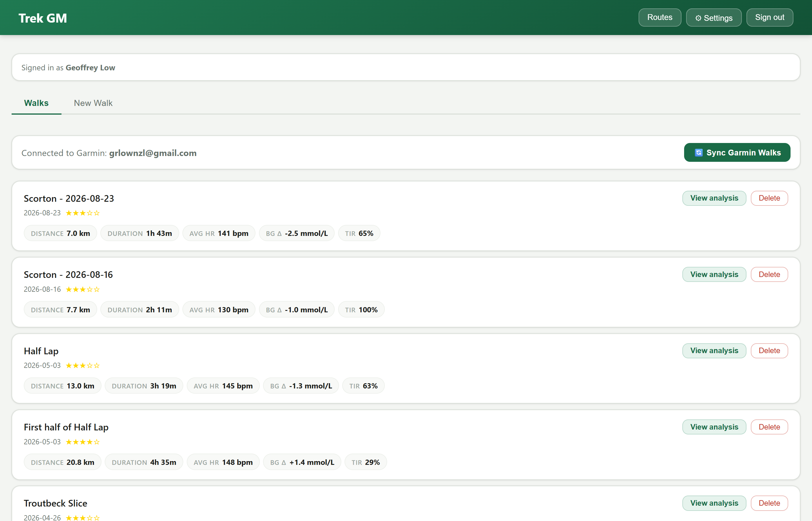
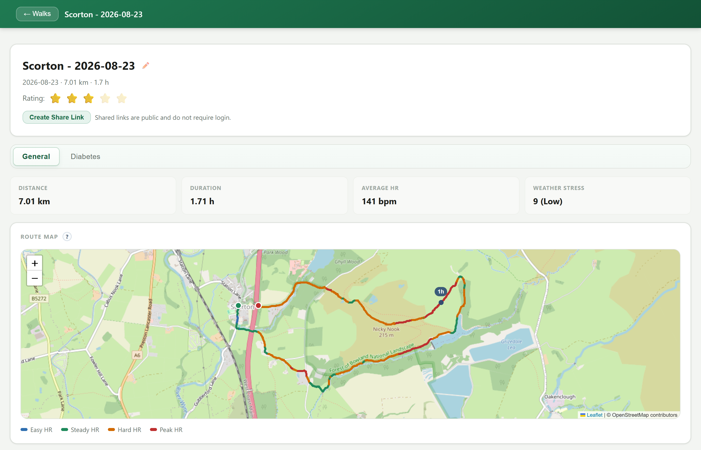
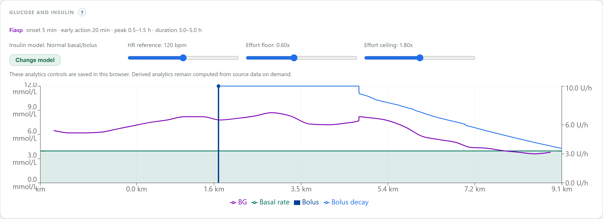
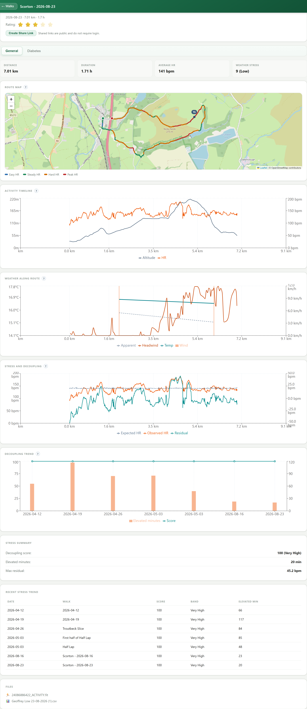
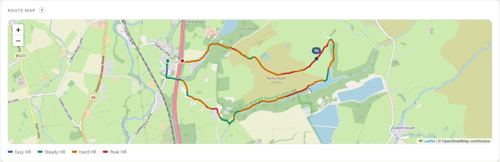
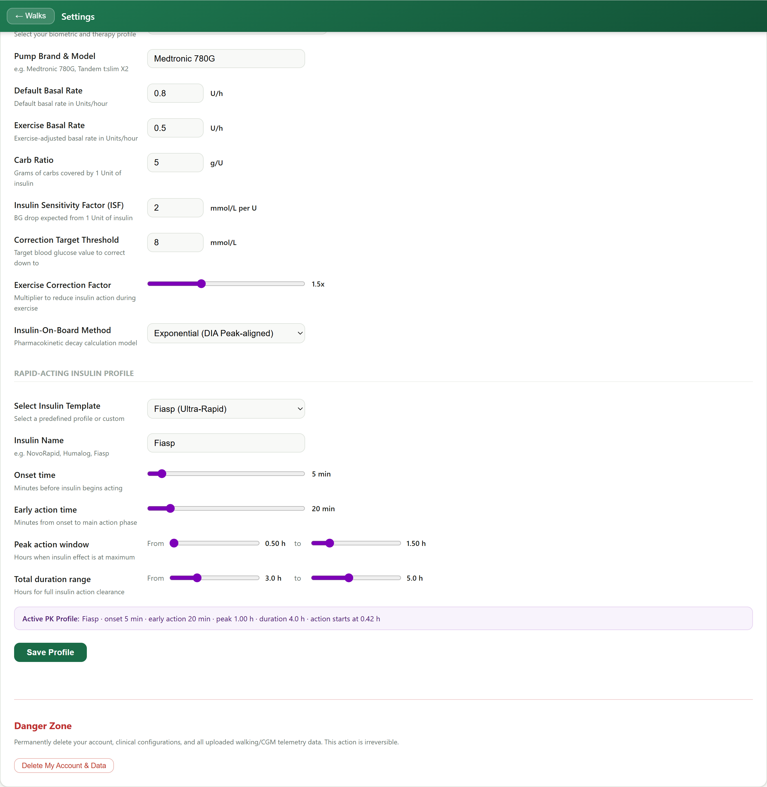
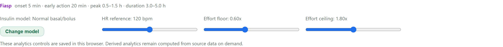

# Walkies

**Walkies** is an open-source web application designed for individuals with diabetes across all regimens (**Closed-Loop AID Pumps** such as MiniMed 780G and Tandem Control-IQ, **Standard Insulin Pumps**, **Multiple Daily Injections / MDI**, and **Non-Insulin / Lifestyle therapy**, as well as **Non-Diabetic CGM users**) and Garmin GPS sport watch users who hike and walk.

The platform aligns and visualizes both **per-walk GPS/activity performance metrics** (heart rate, pace, elevation profile, distance) and **24-hour / multi-day Garmin intraday step and activity epochs (`15-minute` buckets)** with physiological and glycemic signals (continuous blood glucose from Medtronic CareLink, Dexcom Share/Clarity, and Tandem t:connect, basal deliveries, bolus timing, closed-loop automation, and active insulin-on-board).

---

## Key Features

- **24-Hour & Multi-Day Epochal Activity Correlation**: Ingests 15-minute Garmin intraday step counts, active time, heart rate, and activity classifications (`sedentary`, `walking`, `running`, `cycling`, `generic`) and correlates them with 24-hour CGM traces, IOB, and 1–2 hour post-activity lag glucose changes across 1-day, 7-day, 14-day, and 30-day rolling windows.
- **Multi-Track Distance Alignment**: Synchronizes Garmin GPS and biometric tracks with CGM and insulin pump data along route distance, while deduplicating recorded FIT walks from intraday step epochs so steps are never double-counted.
- **Generalized Diabetic Regimen & Unit Support**: Supports Closed-Loop Pump, Standard Pump, Multiple Daily Injections (MDI), Non-Insulin / Lifestyle, and Non-Diabetic CGM profiles, with user-selectable **`mmol/L` or `mg/dL`** display units across all charts, metrics, slopes, and clinical threshold settings.
- **Multi-Provider Cloud Sync & CSV Import**:
  - **Direct Cloud Sync**: Automated synchronization with **Garmin Connect**, **Medtronic CareLink Cloud**, and **Dexcom Share** (US and International/OUS regions), supporting a 7-day default lookback or custom date ranges up to 30 days.
  - **Unified CSV Import**: Auto-detects and imports **Medtronic CareLink**, **Dexcom Clarity** (`mmol/L` or `mg/dL`), and **Tandem t:connect** CSV exports.
- **Dynamic Map Visualization**: Interactive Leaflet maps with route polyline color shading based on heart rate zones or glucose levels, complete with hourly progress markers.
- **Pharmacokinetic Active Insulin (IOB)**: Dynamic active bolus decay curve calculation driven by customizable insulin profiles (Fiasp, NovoRapid, Humalog, Apidra, Actrapid, Humulin S, or custom kinetics).
- **Evidence-Based Metabolic & Exertion Analytics**: Time In Range (`%TIR`), Time Below/Above Range (`%TBR`/`%TAR`), glycemic variability (`%CV`), ATTD consensus sustained hypoglycemia episode detection (`≥15 min`), `>15 min` CGM sensor gap detection, HR drift / decoupling analysis, weather strain evaluation, and exercise risk / recovery guidance grounded in peer-reviewed clinical literature.
- **Secure Sharing Links**: Generate revocable public read-only links to share individual walk analyses, single-day 24-hour summaries, or multi-day aggregate reports with healthcare providers or caregivers without exposing private account data.

---

## Screenshots

### Walk Library & Dashboard

*The landing dashboard provides secure access, walk library browsing, route comparisons, activity rating, and file management.*

---

### Comprehensive Analysis Overview

*The main analysis view correlates activity metrics, altitude, heart rate, and glycemic response against route distance.*

---

### Glucose, Basal Delivery & Active Insulin

*Combines CGM sensor glucose, automated/manual basal deliveries, bolus events, and active bolus decay (IOB) across the duration of the walk.*

---

### Stress & Aerobic Decoupling

*Compares observed heart rate against expected heart rate heuristics to detect physiological strain and cardiac drift.*

---

### Interactive Map View

*Displays the GPS route colored by heart rate intensity, with milestone and hourly progress markers.*

---

## Insulin Profiles & Kinetics

Walkies includes a configurable insulin profile system to accurately model active insulin on board (IOB) decay rather than relying on generic fixed durations.

### Profile Configuration & Clinical Templates

Predefined clinical kinetic templates are included for common insulin analogs:
- **Fiasp** (Ultra-Rapid)
- **NovoRapid** (Rapid)
- **Humalog** (Rapid)
- **Apidra** (Rapid)
- **Actrapid** (Short-Acting / Regular)
- **Humulin S** (Short-Acting / Regular)
- **Custom Kinetics** (User-defined onset, peak window, and total DIA)

### Active Profile in Analysis

*The active profile drives the real-time pharmacokinetic IOB curve displayed alongside basal and bolus events.*

---

## Supported Data Inputs

| Source | Ingestion Mode | Data Extracted |
|---|---|---|
| **Garmin Connect / Watches** | Cloud Sync & `.fit` upload | Recorded walk GPS/elevation/HR tracks, 15-minute intraday step & activity epochs, daily wellness summaries |
| **Medtronic CareLink** | Cloud Sync & `.csv` upload | 24-hour CGM sensor glucose (`SG`), basal rates, bolus volumes, carb entries, SmartGuard states |
| **Dexcom Share & Clarity** | Cloud Sync (US/OUS) & `.csv` upload | 5-minute CGM readings (`EGV` in `mmol/L` or `mg/dL`), fast/long-acting insulin logs, carb entries |
| **Tandem t:connect** | `.csv` upload | CGM readings (`EGV`), basal rate changes, boluses, carb entries, Control-IQ exercise/suspend events |
| **GPS / Mapping Tools** | `.gpx` upload | Route tracks and waypoints (optional fallback) |

---

## Clinical Parameters

- **Glucose Display Units**: Configurable per user (`mmol/L` default or `mg/dL`, `1 mmol/L = 18.0182 mg/dL`); canonical backend storage uses `mmol/L`
- **Target Glucose Range (default)**: 4.0 – 8.0 mmol/L (72 – 144 mg/dL), customizable per user
- **Hypoglycemia Threshold (default)**: ≤ 3.9 mmol/L (70 mg/dL), customizable per user (ATTD consensus: ≥15 consecutive minutes for sustained episode counting)
- **Hyperglycemia Threshold (default)**: ≥ 12.9 mmol/L (232 mg/dL), customizable per user
- **Default Carb Ratio (ICR)**: 5 g/U
- **Default Insulin Sensitivity (ISF)**: 2.0 mmol/L per U (36 mg/dL per U)
- **Standard Duration of Insulin Action (DIA)**: ~4 hours (peak action ~75 min for rapid-acting analogs)

---

## Documentation

- **[Contributing Guide](CONTRIBUTING.md)**: Branching strategy, Spec Kit / literature-first workflow, testing requirements, and pull request guidelines.
- **[Developer Guide](DEVELOPMENT.md)**: Local development setup, environment configuration, database migrations, Docker Compose, testing, and API reference.
- **[Deployment Guide](DEPLOYMENT.md)**: Production deployment on Google Cloud Platform (Cloud Run, Firebase Hosting, Neon PostgreSQL), self-hosting on VPS, and health data governance (UK GDPR / HIPAA).
- **[Analysis Catalogue](Analysis.md)**: Detailed breakdown of implemented and planned physiological, glycemic, and environmental metrics.

---

## License

This project is licensed under the MIT License. See the [LICENSE](LICENSE) file for details.