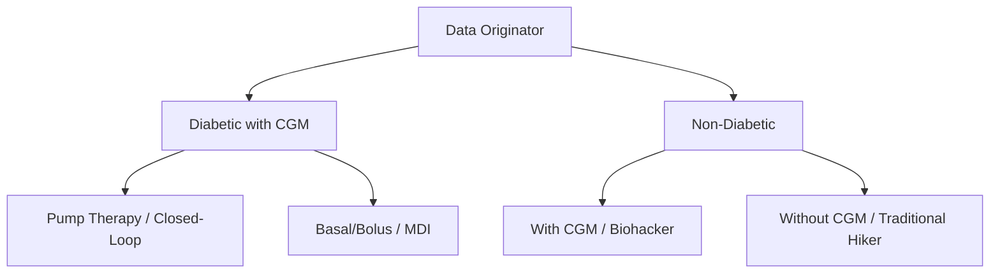

# Walkies — User Personas

This document describes the key users and stakeholders of the Walkies system, categorized by their **Data Originator Profile** and **Secondary Stakeholder Role**. Understanding these profiles guides database schema design, file parsing logic, and frontend feature sets.

---

# Part 1: Primary Data Originators

These are the users who physically perform the walks, record biometrics, and upload data files into Walkies. The system adjusts its analysis capabilities dynamically based on the files and data streams each originator provides.

---

## 1. Diabetic with CGM under Pump Therapy
*“I want to see how my closed-loop pump behaves when I climb hills, and evaluate if it successfully prevents hypos during and after my walks.”*

*   **Current Implementation Level:** 🟢 **Fully Supported**
*   **Status Summary:** Medtronic CareLink CSV (MiniMed 780G) and Garmin FIT uploads are fully integrated. Features include automated parser logic, dynamic active insulin on board (IOB) decay curves, SmartGuard auto-suspend event annotations, and active insulin-stress-effect modeling.

### Profile & Context
*   **User Example:** Geoffrey (primary developer/user of this system).
*   **Clinical Therapy:** Type 1 Diabetes (T1D) using an automated insulin delivery (AID) or hybrid closed-loop (HCL) system.
*   **Hardware Setup:** Medtronic MiniMed 780G pump + Guardian 4 CGM, or Tandem t:slim X2 (Control-IQ) + Dexcom G6/G7.
*   **Typical Data Input:**
    *   **Garmin FIT/GPX:** Activity track (GPS, elevation, distance, heart rate).
    *   **CareLink or Tandem CSV:** Sensor glucose, basal rates, manual/auto-bolus events, pump state (Auto Mode vs. Manual, SmartGuard suspends).

### Core Needs in Walkies
*   **Closed-Loop Visibility:** Wants to overlay pump suspension events (e.g., SmartGuard `PLGM_PREDICTED_LOW_SG` or Control-IQ micro-suspend events) on the glucose and heart rate charts to see if automated basal withholding prevented a low.
*   **Insulin on Board (IOB) Estimation:** Needs to know their active IOB when starting a walk to assess immediate hypo risk.
*   **Insulin-Stress-Effect Modeling:** Needs to see how exercise intensity (heart rate, grade, heat index) dynamically amplifies active insulin effect.
*   **Nocturnal Recovery Tracking:** Needs to analyze post-walk and overnight windows to catch late-onset "exercise lag" hypoglycemia.

### Pain Points
*   **Hypo Anxiety:** High fear of going low in remote areas with high active insulin on board.
*   **Complex Settings Sync:** Adjusting temp targets or exercise profiles on the pump ahead of activity requires planning that is hard to audit without post-exercise review.

---

## 2. Diabetic with CGM on Basal/Bolus (MDI)
*“I don't wear a pump, but I monitor my glucose constantly. I need to know how my pre-walk meal injection affects my glucose trend while hiking.”*

*   **Current Implementation Level:** 🟡 **Partly Supported**
*   **Status Summary:** Users can upload Garmin FIT/GPX activity tracks and select custom or predefined insulin decay profiles (e.g., Humalog, NovoRapid) to compute theoretical kinetics. However, direct ingestion of standalone CGM CSVs (such as Dexcom/Libre exports) is in the backlog, and there is no UI/DB interface for logging manual injection events (boluses).

### Profile & Context
*   **User Example:** Mark (T1D peer).
*   **Clinical Therapy:** Type 1 or insulin-dependent Type 2 Diabetes using Multiple Daily Injections (MDI) via insulin pens and a CGM.
*   **Hardware Setup:** Dexcom G6/G7 or FreeStyle Libre 3 + Garmin GPS watch or mobile phone tracking.
*   **Typical Data Input:**
    *   **Garmin FIT/GPX:** Activity track (GPS, heart rate, elevation).
    *   **Dexcom/Libre CSV:** Sensor glucose (no automatic insulin logs).
    *   **Manual/Secondary Logs:** Injection events (bolus timing/units) recorded manually or extracted from secondary apps.

### Core Needs in Walkies
*   **Manual Bolus Alignment:** Needs the ability to log or import discrete insulin pen doses and correlate their timing relative to walk onset.
*   **Glucose Drop-Rate Analytics:** Focuses heavily on the rate of glucose decline (mmol/L/hr) to decide when to consume rescue carbs.
*   **Personalized Decay Curves:** Relies on manual configuration of their specific fast-acting insulin profile (e.g., NovoRapid, Humalog, Fiasp) to estimate IOB.

### Pain Points
*   **No Auto-Mitigation:** Unlike pump users, their basal insulin cannot be suspended automatically to prevent a drop; they must rely entirely on active carbohydrate consumption.
*   **Data Fragmentation:** Insulin doses are kept in separate apps or logbooks, making it difficult to align with CGM and fitness files.

---

## 3. Non-Diabetic with CGM
*“I wear a glucose sensor for endurance training and metabolic health. I want to optimize my fueling strategy and see when my energy levels dip.”*

*   **Current Implementation Level:** 🔴 **Not Supported (Planned)**
*   **Status Summary:** Not currently supported. Ingestion requires parsing sports CGMs (like Supersapiens/Levels), and the frontend requires layout logic to hide all clinical insulin metrics, IOB calculations, and diabetic hypo/hyper alerts to avoid UI clutter.

### Profile & Context
*   **User Example:** Clara (endurance athlete / biohacker).
*   **Clinical Therapy:** None. Does not take exogenous insulin.
*   **Hardware Setup:** Commercial lifestyle CGM (e.g., Lingo, Levels, Nutrisense, or Supersapiens) + Garmin or COROS GPS watch.
*   **Typical Data Input:**
    *   **Garmin FIT/GPX:** Activity track (GPS, heart rate, power, elevation).
    *   **CGM CSV:** Sensor glucose readings.

### Core Needs in Walkies
*   **Fueling Correlation:** Wants to match glucose spikes and drops with carbohydrate intake timing (e.g., energy gels) to maintain a steady glucose zone during walks.
*   **Metabolic Efficiency:** Analyzes how different paces, terrains, or pre-walk meals affect glucose stability.
*   **No-Insulin View:** Needs a streamlined dashboard version that completely hides insulin-related charts, IOB calculations, and clinical hypo/hyper parameters.

### Pain Points
*   **App Overhead:** Standard diabetic CGM apps are overly focused on insulin and high/low alarms. They want a clean fitness/fueling-centric analysis.
*   **Spikes and Dips:** Difficulty identifying if a sudden drop in energy correlates with a transient glucose dip (reactive hypoglycemia).

---

## 4. Non-Diabetic without CGM
*“I just want to track my walks, look at my route on a map, analyze my heart rate zones, and see how stress affects my performance.”*

*   **Current Implementation Level:** 🟡 **Partly Supported**
*   **Status Summary:** Garmin FIT and GPX parsing for route tracks, elevation profiles, heart rate intensity zones, and stress/decoupling analysis are fully operational. However, the UI does not dynamically adapt to the missing data, displaying empty glucose and insulin panels with missing data warnings instead of a clean, collapsed layout.

### Profile & Background
*   **User Example:** Sarah (traditional fitness walker).
*   **Clinical Context:** Healthy metabolic profile; no glucose tracking.
*   **Hardware Setup:** Garmin, Apple Watch, or GPX tracker.
*   **Typical Data Input:**
    *   **Garmin FIT/GPX:** GPS track, elevation, heart rate, cadence, distance. (No CareLink or CGM CSV files).

### Core Needs in Walkies
*   **Fitness & Effort Analysis:** Wants to see heart rate zones, pace, and altitude changes plotted clearly against route distance.
*   **Stress & Decoupling:** Uses the stress performance charts (comparing observed HR against expected HR based on grade and speed) to identify strain and fitness improvements.
*   **Clean Mapping:** Interactive map colored by heart rate zone with hourly markers.

### Pain Points
*   **UI Clutter:** Most clinical diabetes features are irrelevant and clutter the screen if no CGM/pump files are uploaded. The app should gracefully degrade to a pure fitness and route-compare dashboard.

---

# Part 2: Secondary Stakeholders (Data Consumers)

These users do not generate or upload the physical data streams, but they consume the insights, reports, and analyses generated by the system.

## 5. The Healthcare Provider / Endocrinologist
*“I want to look at consolidated, context-rich exercise reports during clinic visits to help my patient adjust their daily basal rates and exercise parameters.”*

*   **Role:** Clinical advisor who reviews the patient's data periodically.
*   **Interface Preference:** Prefers standardized, high-density, easily shareable summary reports (like standalone HTML exports or secure public links) that do not require registering for an account.
*   **Core Needs:** Needs aggregated clinical metrics for walk windows: Time in Range (TIR), Hypo Count (≤ 3.9 mmol/L), and Hyper Count (≥ 12.9 mmol/L) to verify if the treatment plan is effective under physical strain.

## 6. The Caregiver / Partner
*“I want to support my partner’s active lifestyle, but I also want peace of mind when they are out on solo hikes, and to know what to expect when they recover overnight.”*

*   **Role:** Support system, emergency contact, and co-manager of safety.
*   **Interface Preference:** Mobile-friendly, read-only public sharing links.
*   **Core Needs:** Wants secure, password-free access to a completed walk's safety report to evaluate the risk of nocturnal hypoglycemia and know when to set extra alarms.
